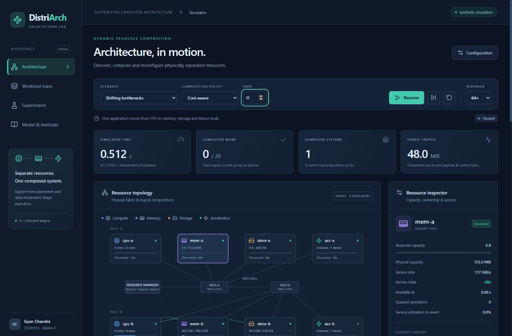
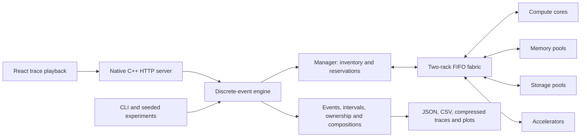
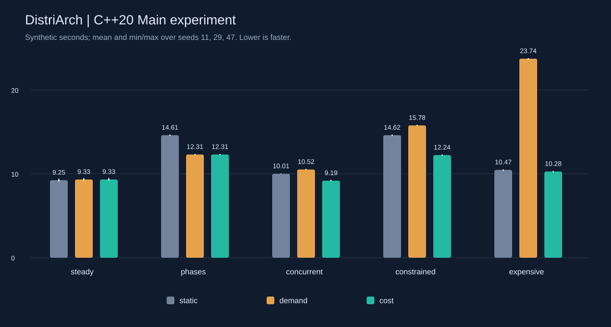

# DistriArch — Dynamic Resource Composition Simulator (C++20)

**Option 2 — Distributed Computer Architecture**

Development of a Distributed Computer Architecture for Unified Management of Physically Separated Compute, Memory, Storage, and Accelerator Resources.

**Gyan Chandra — CS23I1053.** [ProjectStatements.pdf](ProjectStatements.pdf), page 1, was read and visually checked. Only Option 2 is implemented. No other member, faculty or course details were supplied.

**Synthetic architectural simulation, not hardware benchmark measurements.** Every rate/capacity is an illustrative modeling assumption.



This repository contains the C++20 engine, dashboard source, tests, configurations, verified experiment data and dependency licenses. Build outputs, installed dependencies, temporary files and ZIP archives are excluded from Git.

To create the complete shareable Windows archive, build the project and run `.\package.ps1`. It generates `DistriArch_CPP_Complete_Fixed.zip` locally, including native binaries and the built dashboard. Extract that archive and double-click `START_WINDOWS.bat`; [START_HERE.txt](START_HERE.txt) explains offline use on Windows 10/11 x64.

## Four reviewed defects corrected (v3)

1. **Reclaim unused capacity.** Adaptive policies shrink declared live memory/storage ranges in place, release an unused accelerator and reduce idle CPU holdings to one core at a safe boundary. This is an inventory obligation, independent of the owner's speedup and cooldown. The normal commands/acks execute first; ownership changes atomically at commit and waiters are reconsidered. Static retains its initial reservation. Required growth and live migration continue to reserve both sides safely.
2. **Complete transition estimates.** Estimation and execution use the same C++ transition plan: retained storage/memory moves, every additional working-set load (source read, network and destination write), all old/new endpoint commands/acks and accelerator preparation. The queue-free control estimate is the maximum parallel round trip; moves/preparation are sequential. Manager decision service is included as before; preceding telemetry and unpredictable contention are separate.
3. **Preserve custom input across policies.** Policy-only changes update just the policy, retain all other edited fields and clear run/comparison state. Scenario/seed changes intentionally fetch defaults. Abort controllers and independent request epochs prevent stale config/validation/run/comparison responses from restoring old state.
4. **Replay exact event boundaries.** Trace version 3 publishes every ownership, composition, discovery, transition, transfer, phase and service request/completion against an inclusive event index. The dashboard projects one immutable prefix for every stateful view. Same-time changes become visible at their own event, including backward seek. Explicit queue/send/hop records make the operation boundaries inspectable. Final summaries/exports remain authoritative and unchanged by playback.

Historical v2 evidence is explicitly labeled under [evidence/historical-v2/](evidence/historical-v2/README.md). The original submission archive remains a local file and is excluded from Git.

## Launch (native C++20)

The simulation engine, policies, CLI, HTTP server, experiment runner and test harness are implemented in **C++20**. The interactive dashboard remains React/TypeScript. No Python interpreter or Python packages are needed.

C++ build prerequisites: G++ with C++20 support and zlib development files, plus PowerShell. Tested on Windows with **GCC 16.2.0**, **zlib 1.3.2** and **PowerShell 7.6.5**. Add your compiler's `bin` directory to PATH (for example, `C:\msys64\mingw64\bin`); `build.ps1` requires `g++` on PATH. Headers are vendored and pinned; see [THIRD_PARTY.md](THIRD_PARTY.md) and [dependency-lock.json](dependency-lock.json). The native build needs no downloads after installing these prerequisites.

The dashboard build requires **Node.js 22.12+** and **pnpm 11.25.0**; Node 24.22.1 was tested. First frontend setup needs registry access. From PowerShell, clone and build:

```powershell
git clone https://github.com/gyanchandra2910/DistriArch-Dynamic-Resource-Composition-Simulator.git
cd DistriArch-Dynamic-Resource-Composition-Simulator
.\launch.ps1 -Setup
```

Open **http://127.0.0.1:8000**. One native process serves the production dashboard and API. Ctrl+C stops it. Another port: `.\launch.ps1 -Port 8010`.

After the initial build, start subsequent sessions with:

```powershell
.\launch.ps1
```

Use `.\launch.ps1 -Setup` again to rebuild everything. The GitHub source checkout requires this build; a ZIP generated by `package.ps1` already includes the Windows executable and production dashboard and can run offline without Node.js or a compiler.

Build and run the engine independently of the browser:

```powershell
.\build.ps1
.\build\distriarch.exe run --scenario phases --policy cost --seed 11
.\build\distriarch_tests.exe --all
```

Optional CMake workflow (CMake 3.20+, C++20 compiler, zlib):

```sh
cmake -S . -B build-cmake -DCMAKE_BUILD_TYPE=Release
cmake --build build-cmake --config Release
ctest --test-dir build-cmake -C Release --output-on-failure
```

The PowerShell/GCC workflow was executed here. CMake is supplied for portability but was not installed in this environment, so it is not claimed as tested. Verified experiment data is checked in under `results/`. To regenerate it before the integrity suite, run `.\build\distriarch.exe experiments --output results`.

The superseded Python implementation is excluded from Git and is not used by any active build, launch, simulation or test command. Historical migration evidence is retained separately from the current v3 verification records.

## Architecture and sources



| Source | Actual responsibility |
|---|---|
| `include/distriarch/model.hpp`, `src/model.cpp` | C++ configuration/resource types, strict JSON validation, seeded workload generation, hashes and gzip I/O |
| `include/distriarch/engine.hpp`, `src/engine.cpp` | Stable event heap, FIFO network/resource servers, manager, policies, compositions and live-state transitions |
| `src/metrics.cpp` | Trace-derived metrics, ownership/server conservation and work audit |
| `src/experiments.cpp` | 81 bounded native runs, matched baselines, descriptive variation, CSV and standalone SVG |
| `src/main.cpp` | Headless CLI, saved-config runs, audits and native migration-reference verifier |
| `src/server.cpp` | C++ localhost HTTP API and production static-file server; uses the same `run(Configuration)` |
| `tests/native_tests.cpp` | Native analytic and integration test harness; 80 cases (57 original + 23 targeted regressions) |
| `frontend/src/replay.ts`, `tests/replay_tests.mjs` | Shared event-prefix projection/config helpers and 10 frontend regressions |
| `tests/browser_regressions.mjs`, `tests/browser_test_proxy.mjs` | Real browser controls/exports and loopback-only delayed-response fixtures |
| `tests/http_smoke.mjs` | Development-only real HTTP driver comparing complete C++ API and CLI traces; 25 checks |
| `frontend/src/main.tsx`, `types.ts`, `styles.css` | React/TypeScript topology, inspector, fabric queues, timelines, journal, Recharts and exports |

The C++ engine has no dashboard dependency. `Clock` orders by simulated time and a monotonic insertion counter. Deferred callbacks capture owned values; job storage is fixed before scheduling, and indexed JSON records avoid references invalidated by array growth. Task continuations use shared ownership without self-cycles.

No metric is sampled from a random number or animation counter. Modeled completions trigger subsequent operations.

## Model, units and equations

Units are **simulated seconds**, **bytes**, abstract **work units**, CPU **cores**, and one exclusive slot per accelerator. MiB = 2²⁰ bytes. Pools use metadata, not pool-sized host buffers.

Default resources: CPU A = 4 cores × 70 units/core·s; B = 8 × 150. Memory A/B = 512/768 MiB at 1200/280 MiB/s. Storage A/B = 4/8 GiB at 90/650 MiB/s, each with one shared read/write server. Tensor accelerators = 1000/1800 units/s. Endpoint links = 500 MiB/s and 0.8 ms; normal backbone = 180 MiB/s and 3 ms. These are not specifications attributed to commercial products.

```text
CPU duration = work / (reserved cores × per-core rate)
Other service duration = demand / resource rate
Link start = max(hop arrival, link next-free time)
Link finish = start + latency + bytes / bandwidth
Queue wait = start - arrival at the server
```

Each undirected link is a **half-duplex FIFO server** shared by both directions. Whole batched transfers use store-and-forward: enqueue the next hop only after the previous hop finishes. Propagation occupies the link, a conservative abstraction. Concurrent flows cannot each receive the whole shared bandwidth. Routes minimize queue-free latency plus serialization time, without queue prediction. Simultaneous events use stable insertion order.

A job reserves 1, 2 or 4 cores (at most 4 to limit monopolization). CPU service lanes enforce physical limits. Memory/storage each have a FIFO service server independent of byte capacity; accelerators are exclusive. Holdings remain reserved during idle/communication stages.

A phase has a fixed number of logical chunks. Each chunk follows, omitting zero-demand stages:

1. CPU execution.
2. 64-byte storage read request → read service → data storage-to-CPU.
3. Half of batched access bytes CPU-to-memory → memory service → remaining bytes memory-to-CPU.
4. Input CPU-to-accelerator → tensor execution → output accelerator-to-CPU. Without a compatible accelerator, the same work runs on reserved CPU cores and no accelerator transfer is needed.
5. Write data CPU-to-storage → write service.

A phase advances only when its last chunk completes. One application's stages are sequential; different applications, links and servers overlap. Transition control requests can overlap; its preparation/copy tasks are sequential. No generic communication penalty is added on top of actual transfers.

Default bounds: 240 simulated seconds, 100,000 events. Statuses distinguish completed, infeasible, stalled, timeout and event_limit. All-waiting capacity deadlocks after discovery/arrivals are detected before timeout. Unfinished jobs, ages and work remain visible.

## Discovery, composition and live data

At `available_at`, a resource sends registration through the fabric. After 2 ms of inventory service it becomes allocatable. `acc-b` appears physically at **2.5 s**, registers afterward and is used in the concurrent case. Undiscovered resources are never granted.

A `Composition` links CPU/core count, memory pool/bytes, storage pool/bytes and optional accelerator to a job. Ownership is checked on every update. Ownership plus committed mappings defines data placement.

Initial allocation includes manager decision service (4 ms), 512-byte commands and acknowledgements to endpoints, storage-to-memory working-set loading with source/destination service, and optional accelerator preparation. Initial storage contains an existing synthetic dataset.

Dynamic reviews first send a 512-byte current-demand report CPU-to-manager. A transition waits for a chunk boundary:

```text
report → decision → reserve destination while retaining source
→ commands/acks → storage copy if moved → memory copy if moved
→ load additional memory → prepare changed accelerator
→ atomic commit → release obsolete holdings → next unchanged chunk
```

Copies charge source service, transfer latency/bandwidth and destination service. Old live memory remains reserved until copy/commit. CPU private state resides in the memory-pool abstraction. A smaller working-set/storage range declares its discarded suffix dead at that boundary; retained bytes migrate. Adaptive policies reclaim those unused bytes through a paid transition even when it offers no direct execution-time saving. Unused accelerators and idle cores are treated consistently. Extra memory loads from storage. Newly revealed immutable storage input ranges are assumed already present. External dataset creation is omitted. Ownership changes are authoritative local manager metadata; endpoint message costs are explicit.

After logical completion, a completion/release message travels CPU-to-manager and consumes inventory service before resources are reusable. Job flow time ends at logical completion; architecture makespan includes final release. Arbitrary live-capacity deadlocks are reported, not solved by spilling/eviction.

## Actual policies and information boundary

A controller `Observation` contains only the revealed phase, its remaining chunks, current mapping, last successful change and waiting time. The controller sees discovered inventory, present reservations and fabric parameters. It never inspects future phases/arrivals. A behavioral test changes both and requires identical earlier events and allocations.

All policies use identical hardware, generated work, arrivals and costs. Common initial placement minimizes estimated current-chunk duration over discovered feasible compositions, with a small core-holding tie-break. Equal service-cost choices prefer retaining existing endpoints, so an unused stage never causes a migration just because its ID sorts earlier. Static sizing never reads future maxima. Estimates sum the equations above without predicting queueing.

| Policy | Rule |
|---|---|
| Static | Keep initial mapping until completion. A future phase exceeding reserved capacity is explicitly infeasible. |
| Demand-driven | At phase boundaries and periodic 0.8 s reviews, minimize estimated current chunk time, ignoring switching cost. Finish the running chunk first. |
| Cost-aware | Benefit = (current − candidate chunk cost) × remaining current-phase chunks. Accept only if benefit > 1.2 × estimated switching cost + 0.040 s, with a 1.5 s cooldown after the last change. Required growth and safe in-place reclamation bypass the optional-benefit gate; both pay their actual transition costs. |

Switching estimates include decision service, queue-free control round trip, live copies and preparation. This transparent heuristic is neither ML nor an optimizer. It cannot forecast congestion or future phases and can lose. Oldest waiting requests are considered first; core caps limit monopolization. All feasible default finite-batch jobs finish. No universal fairness guarantee for an unbounded arrival stream is claimed.

## Reproducible experiments and actual findings

The generator varies logical CPU demand by ±10% with a seed; output metrics are never randomized. Other sizes are controlled. Workloads cover CPU-heavy work, 96 MiB memory batches, large storage I/O, tensor work, changing phases and concurrent unequal work. Workload/hardware hashes verify matched inputs.

| Scenario | Purpose |
|---|---|
| steady | Stable CPU work, little adaptation benefit |
| phases | CPU → memory → storage → tensor bottlenecks |
| concurrent | Four unequal applications, queues, release/reuse and late accelerator |
| constrained | Phase pipeline with a 24 MiB/s backbone |
| expensive | Short alternating phases, 192 MiB live state, 60 MiB/s backbone and 700 ms preparation |

**81 runs executed again with the C++20 executable**, all completed without audit violations or unfinished jobs:

- Main: 5 scenarios × 3 policies × seeds **11, 29, 47** = **45**.
- Sensitivity: **24/90/360 MiB/s** backbone × 3 policies × 3 seeds = **27**; only bandwidth changes.
- Idealized ablation on expensive: 3 policies × 3 seeds = **9**.

The explicitly **idealized zero-reconfiguration** ablation removes committed switching's commands/acks, state copies and preparation. It retains capacity constraints, discovery, initial allocation, reports/decision evaluations, release and workload operations. Policies may choose differently when switching estimates become zero. It is not realizable hardware.

Mean makespan in **simulated seconds**, lower is faster:

| Scenario | Static | Demand-driven | Cost-aware | Cost-aware vs static |
|---|---:|---:|---:|---:|
| Steady | 9.2471 | 9.3331 | 9.3331 | **−0.93%** |
| Phase changes | 14.6149 | 12.3114 | 12.3114 | **+15.76%** |
| Concurrent | 10.0118 | 10.5239 | 9.1930 | **+8.18%** |
| Constrained fabric | 14.6150 | 15.7787 | 12.2433 | **+16.23%** |
| Expensive/short phases | 10.4714 | 23.7368 | 10.2841 | **+1.79%** |

Improvements are calculated against the same scenario/seed, then averaged. Min/max and sample SD appear in saved JSON and the dashboard. Three seeds describe variation, not statistical significance. CPU-only perturbations produce limited variation in memory/storage-dominated cases.

**Negative results:** both adaptive policies lose on steady work despite making no changes, because reports/reviews still cost time. Demand-driven loses in four main scenarios and takes about 2.27× static's time on short phases because it repeatedly migrates live state. At normal bandwidth both adaptive policies make three changes and tie on the phase pipeline. Under the constrained fabric, cost-aware rejects the memory moves and only adds an accelerator. Its concurrent improvements apply to these finite demands, not all workloads.

Demand-driven's bandwidth sweep is **15.7787 s at 24**, **12.8506 s at 90**, **12.0541 s at 360 MiB/s**. Cost-aware is **12.2433 / 12.8506 / 12.0541 s**, respectively: its threshold admits additional migrations as bandwidth improves, so the heuristic's result is not monotonic. Static is almost unchanged because its placement avoids backbone data migration. Idealized free switching on short phases reduces demand-driven from **23.7368 to 8.4683 s**; cost-aware is **10.1285 s**, static **10.4714 s**. Cost-aware's cooldown can still reject a useful short change when switching is free. It is not forced to win.



**Changed findings:** 30/81 makespans changed; 51 were numerically unchanged. The default scenarios do not contain memory-size growth, so the estimator correction is exercised by analytic regressions and supplied shrink fixtures. The small main/sensitivity changes come from complete old-endpoint commands/acks. Expensive/short phases additionally reclaim an unused accelerator (cost-aware now 2 changes; demand-driven 5), with real control time. The improved inventory behavior is not forced to improve a single-owner makespan. Full before/after data: [fixed-results-diff.json](evidence/fixed-results-diff.json).

In the supplied memory-shrink demonstration, B now starts at **2.5704 s** instead of **12.5750 s**, while A finishes at **12.3626 s**. Storage shrink starts B at **2.2104 s** instead of **12.2150 s**. Both adaptive policies finish all three logical chunks without a capacity violation. Examples are under [tests/fixtures/](tests/fixtures/shrink-memory-cost.json); details: [fixed-reclamation.json](evidence/fixed-reclamation.json).

## Metrics and denominators

All denominators cover t=0 through termination, including discovery/idle time. Busy intervals clip at timeout. Metrics are recomputable from saved records.

| Metric | Definition |
|---|---|
| Completed/unfinished work | Fixed completed/total chunks plus logical_work total/completed/unfinished CPU units, memory bytes, reads/writes, tensor units and logical accelerator bytes. Partial chunks remain unfinished. Actual accelerator traffic depends on fallback. |
| Makespan | Architecture elapsed time, including final release; elapsed termination time on incomplete runs. completed_job_makespan separately gives last logical completion or null. |
| Flow time / initial wait | Completion minus arrival; arrival to first committed composition. Null when unfinished/never started. released separately gives reuse time. |
| Queueing | Sum of waits at resource, manager and link servers for that job, including control. Elapsed waits clip at termination; never add them twice to makespan. |
| Throughput | Completed jobs / elapsed simulated seconds; chunks/s also reported. Unfinished jobs counted separately. |
| CPU utilization | Busy core-seconds / (physical cores × elapsed time), including fallback. |
| Memory/storage occupancy | Reserved byte-seconds / (byte capacity × elapsed time), including both sides of migration. |
| Other service utilization | Busy seconds / elapsed time, including placement/copy/preparation. Reservation utilization is separate for every kind. |
| Link utilization / q | Occupied serialization+propagation seconds / elapsed time; q counts requests waiting to enter a link at the displayed event. |
| Traffic | Completed end-to-end bytes count once; link_byte_hops counts fully completed hops. Partial transfers remain in raw records; partial serialized bytes are not estimated. |
| Reconfiguration | Count after initial placement; summed reservation-to-commit time; completed switching control/data bytes. Time can overlap across jobs. Preceding report/decision costs are separate. |
| Manager overhead | Busy registration, decision, release-update seconds; utilization and all control bytes separately reported. Network delay already affects events. |
| Fairness/starvation | Jain index on job completed fractions: (sum f)²/(N × sum f²). It reaches 1 on completed batches, so inspect maximum initial wait, queueing, unfinished IDs/ages as well. |

## Commands, saved evidence and development

Run `.\verify.ps1 -SkipBuild` to regenerate/audit all 81 experiments and execute the 80 native tests plus 25 real HTTP/CLI checks and 10 frontend replay/config tests. Stop the running server before rebuilding its executable. `.\verify.ps1 -SkipBuild -SkipHttp` needs only the native binaries.

```powershell
.\build\distriarch.exe run --scenario phases --policy cost --seed 11 --output tmp\run.json
.\build\distriarch.exe run --config configs\concurrent.json --output tmp\concurrent.json
.\build\distriarch.exe config --scenario expensive --policy demand --seed 29 --output tmp\custom.json
.\build\distriarch.exe experiments --output results
.\build\distriarch.exe audit results\traces\main-phases-11-cost.json.gz
.\build\distriarch_tests.exe --all
node tests\http_smoke.mjs
cd frontend
pnpm run typecheck
pnpm run build
```

Development: start backend, then `pnpm dev` in frontend in a second terminal. Vite proxies /api to port 8000. Production needs one server. API contract: [docs/API.md](docs/API.md). Endpoints: GET /api/config/{name}; POST /api/validate, /api/run, /api/compare; GET /api/experiments. Comparison clones the exact input. At most two API simulation requests execute concurrently.

Saved outputs: results/runs.csv, results/summary.json (job/resource metrics and aggregates), results/traces/*.json.gz (full config, events, intervals, transfers, ledger and mappings for all 81 runs), and results/main-comparison.svg. Charts use saved simulator results.

## Classroom walkthrough

1. Select **Shifting bottlenecks / Cost-aware / seed 11**, then **Run simulation**. Backend computes a real trace. Pause/Resume, event-step, event cursor and 1×–64× playback inspect it without changing the result. Simultaneous events can step without advancing time.
2. Click resources: reservation bars, service busy/utilization, owners and queues are distinct. Moving dots follow actual directed hop intervals; dashed lines are compositions.
3. Inspect Fabric activity, phase/allocation timelines, Decision journal and the Workload trace operation lanes.
4. Compare policies runs the selected input. Makespan and summed transition time are separate metrics. Experiments shows saved main, min/max/SD, sensitivity and labeled ablation.
5. Export Config or Result & trace JSON. Reload configuration in CLI. Final evidence is labeled final even while paused. Reset and scenario/policy/seed changes invalidate older responses and clear old trace/comparisons.
6. Configuration validates before applying edits. Identity/policy/seed follow selectors. Errors retain the last valid input. Narrow layouts scroll topology/timelines/tables inside panels.

## Completed requirement mapping

The checklist was created before implementation, then reconciled against Option 2 and the detailed brief. Exact QA commands/evidence: [QA.md](QA.md).

| Statement clause / brief requirement | Implementation | Verification | Status |
|---|---|---|---|
| Separate compute, memory, storage, accelerators | Typed finite pools, capabilities, states, two of each, independent queues | Analytic CPU/service/accelerator tests; topology | Complete |
| Dynamically organized unified system | Explicit Composition, inventory and ownership ledger | Conservation and histories for 81 traces | Complete |
| Discovery | Registration over fabric, inventory service, late acc-b | 45 ms hand calculation; late discovery/use | Complete |
| Allocation, release, reuse | Reservations, commands/acks, completion report and inventory update | Capacity/reuse/release tests; concurrent trace | Complete |
| Remote communication costs | Directed store-and-forward FIFO half-duplex links, bytes | 220 ms transfer; 220/330 ms contention; sweep | Complete |
| Runtime reconfiguration overhead | Reports/decision, boundary, live copies, preparation, retain/commit/release | 2.22 s migration and 47 ms report/decision; ownership retention | Complete |
| Resources/interconnect/manager/workloads interact | Dependent chunk services/transfers | All policies/scenarios; work/server audit | Complete |
| Feasibility and overhead evaluation | Three matched policies, positive/negative findings | 45 main + 27 sensitivity + 9 ablation | Complete within model assumptions |
| Workloads/phases/concurrent unequal demands | Seeded immutable inputs, current-only observations | Hashes, repeatability, future perturbation | Complete |
| Bounds and invalid/infeasible requests | Strict schema, horizon/budget, stalled detection | Invalid, growth, live-deadlock and timeout cases | Complete |
| Explainable decisions, fairness, hysteresis, rejection | Estimates, aged waiters/core caps, cooldown/threshold | Accepted/rejected decisions; finite-batch completion | Complete; no unbounded-stream guarantee |
| Defined metrics/configs/traces/plots | Trace-derived JSON/CSV/gzip/SVG | Denominator, reconciliation and corruption tests | Complete |
| Dashboard controls/views/export | React/TypeScript/Recharts/shared C++ API | Production launch and genuine browser QA/screenshots | Complete; see QA record |
| CLI/API identity, replay/reset/stale behavior | Same engine, immutable cursor, cancellation/generation | CLI/API equality; browser exports/controls | Complete |
| Three executed QA passes/local deliverables | Analytic, integrity/experiments, build/browser regression | QA.md and evidence/ | Executed |

## Honest scope and limitations

High-level, non-cycle-accurate simulation. Omitted: caches/coherence, instruction pipelines, address translation/page faults, packet transport/retransmission, actual RDMA, failures, power/thermal modeling, consensus and hardware validation. Batching, whole-transfer occupancy, authoritative manager metadata and chunk-boundary transitions are explicit simplifications; service rates are constant.

Estimates ignore future queues and can lose. Live-capacity deadlocks are detected rather than solved by spilling. The grouped topology is for small classroom systems, not general large-graph editing. Bounds: 24 resources, 60 links, 16 applications. Playback replays a simulation; it does not operate a physical cluster. PDF reporting and external deployment/publication are outside this stage. The fixed Windows ZIP is included.
